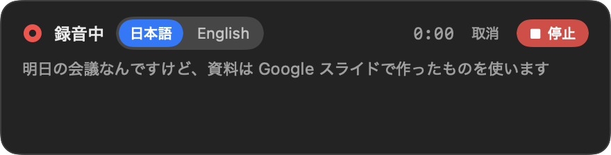
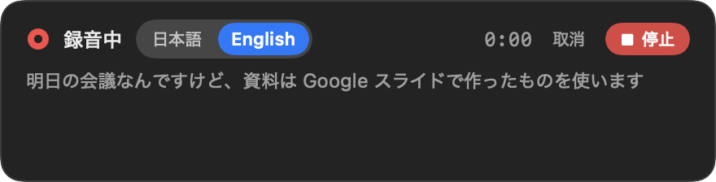
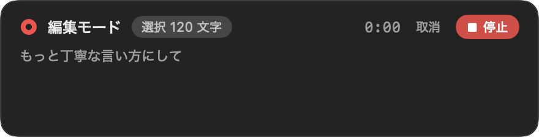
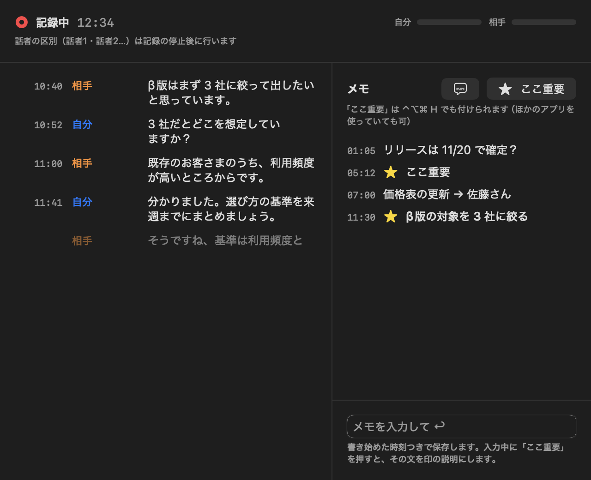
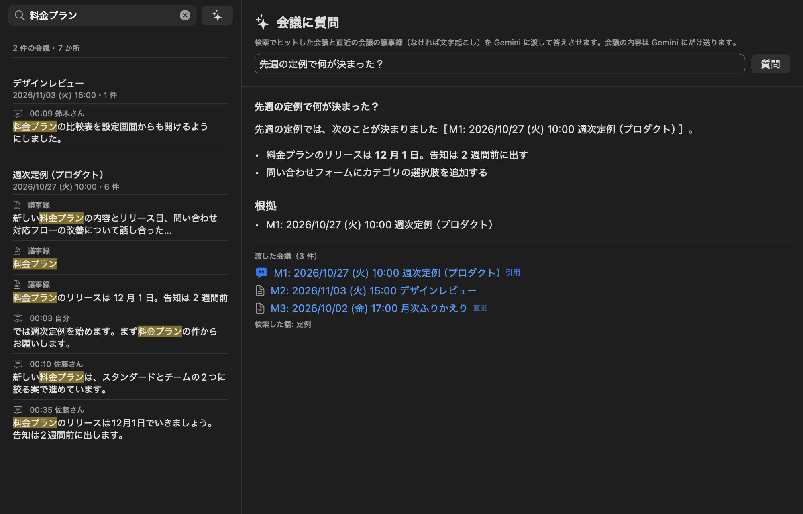
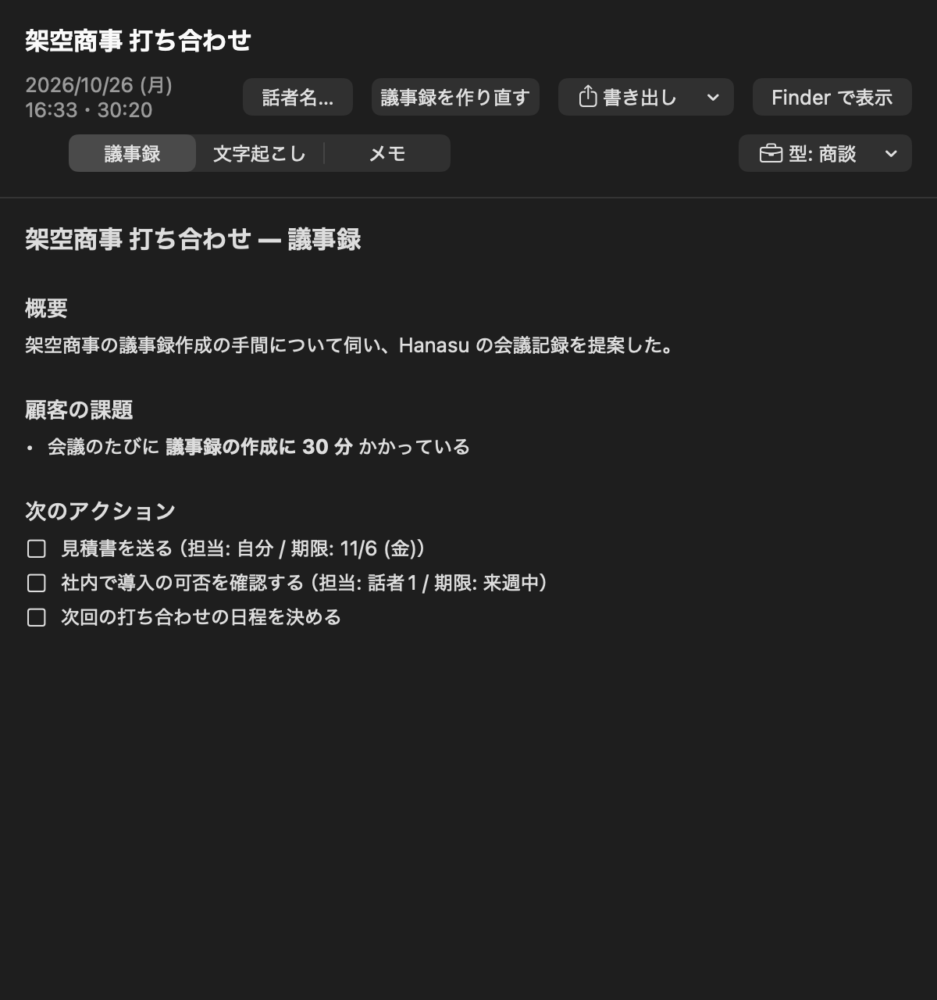
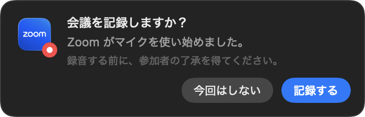

<div align="center">


# Hanasu

**Говорите естественно. Получайте чистый текст, готовый к отправке, и протоколы встреч, которые пишутся сами.**

Приложение для голосового ввода и заметок о встречах для macOS и Windows. Оно использует распознавание речи на устройстве, а также Gemini, Claude или ИИ-модель, которая работает на вашем собственном устройстве.

[](https://github.com/kakibara/hanasu/releases/latest)
[](https://github.com/kakibara/hanasu/releases)
[](COMMERCIAL.md)


[](https://github.com/kakibara/hanasu/actions/workflows/windows.yml)

[English](README.md) · [日本語](README.ja.md) · [简体中文](README.zh-CN.md) · [繁體中文](README.zh-TW.md) · [한국어](README.ko.md) · [Español](README.es.md) · [Français](README.fr.md) · [Deutsch](README.de.md) · [Italiano](README.it.md) · [Português (Brasil)](README.pt-BR.md) · **Русский** · [Türkçe](README.tr.md) · [Tiếng Việt](README.vi.md) · [Bahasa Indonesia](README.id.md) · [Polski](README.pl.md) · [العربية](README.ar.md) · [हिन्दी](README.hi.md)

<sub>Это перевод README на английском языке. Если они расходятся, актуальнее всего английский README.</sub>



</div>

> [!NOTE]
> Hanasu создан в первую очередь для **японского** языка, и японский протестирован лучше всего.
> Интерфейс приложения и инструкции, которые оно даёт ИИ, доступны на тех же 17 языках, что и этот README. Интерфейс следует языку системы, а инструкции для ИИ — языку расшифровки в настройках. Для любого другого языка Hanasu использует английский.
> Он также может перевести сказанное на естественный **английский**, на **японский** или на любой из 17 поддерживаемых языков, прежде чем ввести текст.

## Зачем нужен Hanasu

Встроенная диктовка выдаёт сырую расшифровку. В ней остаются слова-паразиты и ошибки в омофонах, нет пунктуации, и сохраняется каждое «стоп, то есть…».
Hanasu отправляет расшифровку ИИ (Gemini, Claude или локальной модели на вашем устройстве), который исправляет эти ошибки и приводит текст в порядок. Затем Hanasu вводит результат туда, где стоит курсор.
Проект вдохновлён Typeless, Wispr Flow, Aqua Voice и Granola. Исходный код Hanasu общедоступен. Hanasu бесплатен для личного использования и для малого бизнеса; более крупным компаниям нужна [коммерческая лицензия](COMMERCIAL.md). Вы используете собственный API-ключ Gemini или Claude либо запускаете локальную модель — без API-ключа и без того, чтобы текст покидал ваше устройство.

## Возможности

### 🎙️ Голосовой ввод

| | |
| --- | --- |
| **Речь → отточенный текст** | Нажмите <kbd>⌥ Space</kbd>, говорите и нажмите ещё раз (или нажмите **■ Готово**). Hanasu убирает слова-паразиты, исправляет омофоны, учитывает ваши самоисправления и вставляет текст в позицию курсора. |
| **Говорите — вводится перевод** | Нажмите <kbd>⌥⇧ Space</kbd> или переключите HUD на **English**, **日本語** или другой язык во время речи. Устойчивые выражения переводятся естественно, так что お疲れ様です превращается в "Hi,". Выберите предлагаемые языки (любые из 17 поддерживаемых) в **Настройки → Основные**. По умолчанию — английский. На Mac в **Настройки → Приложения** можно задать, на каком из этих языков начинать ввод в конкретном приложении. |
| **Смешанные языки остаются как сказано** | По умолчанию то, что вы говорите по-английски, остаётся на английском. Вместо этого можно выбрать приведение всего результата к японскому. |
| **Редактирование голосом** | Выделите текст, нажмите <kbd>⌃⌥⌘ E</kbd> и скажите «сделай вежливее», «оформи списком» или «переведи на английский». |
| **Стили для приложений** | В Slack текст короткий и неформальный, в Mail — вежливый и с абзацами, а в Pages, Word и Notion — в письменном стиле. Пресет можно изменить для каждого приложения или научить ИИ собственному стилю на примере ваших текстов (вставьте текст или выберите файл Word, текстовый файл или файл Markdown). |
| **Сниппеты** | Скажите «подпись письма», чтобы вставить сохранённый текст ровно в том виде, в каком вы его написали. Сниппеты никогда не отправляются ИИ. |
| **Словарь** | Добавляйте имена собственные и правила замены, например `ストックマーク => Stockmark`. Правила замены применяются и к расшифровкам встреч. Для встречи, открытой в «Заметках о встречах», ИИ может предложить новые записи на основе этой встречи (на Mac — также на основе вашей истории и недавних встреч), а вы добавляете только выбранные. С помощью пункта меню **Найти кандидатов для словаря на экране…** Hanasu читает слова на ваших экранах и предлагает их вместе с тем, как они, скорее всего, будут распознаны на слух (например, `Jスリー => J3`); прежде чем что-либо уйдёт в ИИ, вы видите, что будет отправлено. |
| **Контекст экрана** *(по желанию)* | Hanasu читает заголовок окна и текст вокруг курсора, чтобы имена совпадали с тем, что уже есть на экране. Поля паролей никогда не читаются. |
| **Текст со снимка экрана** *(по желанию, Mac)* | Hanasu делает снимок всех ваших дисплеев, распознаёт текст прямо на Mac и передаёт ИИ только этот текст, чтобы имена и номера моделей из других окон (например, «QX-7s») писались так же, как на экране. Изображение никогда не отправляется и не сохраняется. Кнопкой в HUD это можно включить или выключить для одной записи. Нужно разрешение «Запись экрана». |
| **Выбор микрофона** *(Mac)* | Выберите микрофон в настройках или переключите его кнопкой микрофона в HUD, не останавливая запись. |
| **История** | Ищите прошлые результаты и повторяйте неудавшиеся. По умолчанию история хранится 30 дней, это можно изменить в настройках. На Mac нажмите <kbd>⌥⇧ V</kbd>, чтобы снова вставить последний результат. |
| **Некуда вставить?** | Если ни одно текстовое поле не в фокусе (например, на переднем плане рабочий стол), Hanasu оставляет результат на экране вместо вставки. Скопируйте его оттуда или просто нажмите <kbd>⌘V</kbd> там, где он нужен (можно выбрать, остаётся ли результат в буфере обмена). |
| **Вставка не дошла?** | Если вставка так и не попала в приложение (например, вы переключили окно во время записи), Hanasu оставляет последний результат в буфере обмена и сообщает об этом в HUD. Нажмите <kbd>⌘V</kbd> там, где он нужен. В разделе «Настройки → Основные» можно также включить открытие истории диктовки в таких случаях. |

<p align="center">
  
  
</p>

### 📝 Заметки о встречах

| | |
| --- | --- |
| **Запись обеих сторон** | Ваш микрофон записывается как «вы». Аудиовыход Mac (Zoom, Meet, Teams, хаддлы Slack и так далее) записывается как «собеседники». Никакой бот к звонку не подключается. |
| **Разделение по спикерам** | Другая сторона разделяется на Спикера 1, Спикера 2 и так далее — прямо на устройстве. Когда имя становится понятно из разговора (например, кто-то представился), ИИ подставляет его и помечает как предположение. Спикеров можно переименовать позже. |
| **Протоколы от ИИ** | Создаются ИИ, который вы выбрали для встреч. Выберите шаблон: авто, еженедельная встреча, 1-on-1, звонок с клиентом, мозговой штурм или свой. У задач указаны ответственный и срок. |
| **Источник и повторное прослушивание** *(Mac)* | Протокол открывается одной страницей: сначала резюме и задачи, рядом — расшифровка. Нажмите на время после пункта, чтобы перейти к реплике, из которой он взят. Запись можно воспроизвести с любой реплики, а если в звонке было эхо — выключить звук своей стороны или собеседников. |
| **Заметки и отметки в реальном времени** | Пишите заметки с метками времени во время звонка или нажмите <kbd>⌃⌥⌘ H</kbd>, чтобы отметить «это важно» (отменить можно в течение 10 секунд). В протоколе этим местам отдаётся приоритет, а позже можно прочитать разговор вокруг каждой отметки. |
| **Плавающие субтитры** *(Mac)* | Показывайте расшифровку в реальном времени как субтитры поверх приложения для встреч. Если оставить их включёнными, они появятся и на следующей встрече. |
| **ИИ-чат во время встречи** *(Mac)* | Во время записи спрашивайте ИИ о разговоре до текущего момента (<kbd>⌘J</kbd>). «Итоги на данный момент» или «решения и задачи» — одним щелчком. Задавайте уточняющие вопросы и нажмите на метку времени в ответе, чтобы перейти к этому месту расшифровки. Вас неожиданно спросили, пока вы были заняты другим? Нажмите **О чём меня спросили?** в субтитрах (или <kbd>⌃⌥⌘ A</kbd>), не уходя из приложения для встреч: на плавающей панели появятся последние реплики собеседников, а затем сводка ИИ — в чём вопрос и как обсуждение к нему пришло. ИИ и модель для этого разговора можно сменить в меню под полем ввода. |
| **Обнаружение встреч** | Когда приложение для встреч начинает использовать микрофон, Hanasu спрашивает, нужно ли записывать. Сам он запись никогда не начинает. |
| **Поиск и вопросы** | Ищите по тексту всех встреч или спросите: «Что мы решили на встрече на прошлой неделе?». В ответе указаны встречи, на которые он опирается. |
| **Экспорт** | Копируйте в Markdown или как сводку, готовую для Slack, сохраняйте в `.md` / `.txt` или отправляйте задачи в Напоминания. |
| **Упорядочивание** | Переименуйте встречу, отредактировав заголовок прямо на месте, или удалите встречу, которая больше не нужна. |

<p align="center">
  
  
</p>
<p align="center">
  
  
</p>

### 🤖 Выбор ИИ

Выберите ИИ, который шлифует текст, — отдельно для **голосового ввода** и для **встреч** (протоколы). На Mac также выбирается ИИ для **ИИ-чата и вопросов** (ИИ-чат встречи и вопросы о прошлых встречах).

| ИИ | Модель по умолчанию | Вход |
| --- | --- | --- |
| **Gemini** (по умолчанию на Windows) | голосовой ввод `gemini-3.5-flash-lite`, встречи и ИИ-чат и вопросы `gemini-3.8-flash` | API-ключ Google AI Studio или сервисный аккаунт Vertex AI |
| **Claude** | голосовой ввод и ИИ-чат и вопросы `claude-haiku-5-5`, встречи `claude-sonnet-5-5` (также доступна Opus 5.5) | API-ключ Anthropic |
| **Локальный** (на вашем устройстве; по умолчанию на Mac) | Gemma 4 E4B (рекомендуется). См. таблицу ниже | Не нужен. Скачайте модель в **Настройки → ИИ**. На Mac, если модели нет, когда Hanasu начинает шлифовать текст, он спросит, скачать ли её |
| **Apple** *(Mac, macOS 27)* | Модель Apple Intelligence на устройстве, через команду `fm` | Не нужен |

Эти ИИ работают только с текстом. Речь расшифровывает движок, описанный ниже.

#### 💻 Локальные модели

В режиме **Локальный** Hanasu запускает небольшую языковую модель на вашем Mac или ПК с помощью встроенного [llama.cpp](https://github.com/ggml-org/llama.cpp), так что текст никогда не покидает устройство. На Mac используется GPU (Metal), на Windows — CPU. Модель скачивается один раз в **Настройки → ИИ**. Перед использованием Hanasu проверяет её размер и SHA-256.

| Модель | Размер | Лицензия | Примечания |
| --- | --- | --- | --- |
| **Gemma 4 E4B** (Google) — **рекомендуется** | 4.59 GB | Apache-2.0 | Самые естественные результаты и при очистке текста, и в протоколах. Рекомендуется 16 ГБ памяти или больше. Используется по умолчанию и для голосового ввода, и для встреч |
| LFM2.5-1.2B-JP (Liquid AI) | 1.25 GB | LFM Open License v1.0 | Маленькая и быстрая. По этой лицензии организации с годовой выручкой от 10 млн долларов США не могут использовать её в коммерческих целях |
| Sarashina2.2 3B (SB Intuitions) | 2.07 GB | MIT | Обучена на японском. Контекст — 8K, поэтому длинные встречи резюмируются по частям |
| Qwen3.5-4B (Alibaba) | 2.74 GB | Apache-2.0 | Примерно вдвое меньше Gemma, поэтому её проще запустить при 8 ГБ памяти. Хуже Gemma справляется с самоисправлениями |

> [!TIP]
> Мы рекомендуем **Gemma 4 E4B**. В наших тестах другие модели иногда оставляли слова, от которых вы хотели отказаться, добавляли фразы, которых вы не говорили, путали ответственного за задачу, а также объединяли или пропускали задачи. Gemma 4 E4B надёжно справилась и с очисткой текста, и с протоколами.

### 🔊 Выбор движка распознавания речи

| Движок | Где работает | Расшифровка в реальном времени | Примечания |
| --- | --- | --- | --- |
| **Стандартный движок ОС** (по умолчанию) | Mac: `SpeechAnalyzer` · Windows: `Windows.Media.SpeechRecognition` | ✅ | На Mac работает на устройстве |
| **Whisper** | На устройстве (WhisperKit на Mac, whisper.cpp на Windows) | — (после остановки) | Модель скачивается при выборе |
| **Gemini** | Google | — (после остановки) | Записанный звук отправляется в Google |

Для голосового ввода и для встреч можно выбрать разные движки. На Windows для встреч используется Whisper или Gemini.
На Mac язык расшифровки выбирается из списка (японский, английский, китайский, корейский, французский, немецкий, испанский, итальянский, португальский). Изначально установлен язык системы.

### ⌨️ Работа из терминала и ИИ-агентов

Команда `hanasu` позволяет скриптам и ИИ-агентам (Claude Code, Claude Desktop и другим) читать записи ваших встреч и использовать ваш стиль обработки текста. Она входит в состав приложения, поэтому больше ничего устанавливать не нужно: на Mac это само приложение, а на Windows — `cli\hanasu.exe` в папке Hanasu. Откройте **Настройки → Команда и MCP**, чтобы подключить её к Claude Desktop, ChatGPT (Codex) или Claude Code одним нажатием, добавить её в PATH или скопировать настройку MCP для других приложений. (Обычный чат ChatGPT пока не может использовать локальные инструменты MCP из-за ошибки OpenAI; Codex может.)

| | |
| --- | --- |
| **Чтение встреч** | `hanasu meetings list / show / search` и `hanasu actions` выводят встречи, протоколы, расшифровки и задачи — текстом или в `--json`. Ничего никуда не отправляется. |
| **Вопросы** | `hanasu ask "Что мы решили на прошлой неделе?"` отвечает по вашим встречам. На Mac используется ИИ, выбранный для **ИИ-чата и вопросов** (а если он не выбран — ИИ для встреч); на Windows — ИИ для встреч. |
| **Обработка текста** | `hanasu refine` шлифует или переводит текст так же, как голосовой ввод, а `hanasu edit "<инструкция>"` переписывает его. Обе команды работают в конвейерах. Параметр `--app` выбирает стиль для приложения (на Mac — bundle ID, на Windows — имя exe-файла, например `slack.exe`). |
| **MCP для ИИ-агентов** | `hanasu mcp` — это MCP-сервер (stdio). Агенты могут получать список ваших встреч, читать их, искать по ним и задавать по ним вопросы. Содержимое встреч, переданное таким образом, попадает к агенту и поставщику его ИИ. |
| **Проверка настройки** | `hanasu doctor` показывает, какой ИИ и какие учётные данные используются, папку встреч и как зарегистрировать MCP. Все параметры — в `hanasu help`. |

На Windows перед чтением вывода в PowerShell выполните `[Console]::OutputEncoding = [Text.UTF8Encoding]::new()`. Если API-ключ защищён с помощью Windows Hello, подтверждение запрашивается каждый раз, когда команда его использует.

На Mac администраторы могут отключить команду, MCP или некоторые ИИ с помощью профиля конфигурации.

## Скачать

Последнюю сборку можно скачать на странице [**Releases**](https://github.com/kakibara/hanasu/releases/latest).

| Платформа | Файл | Требования |
| --- | --- | --- |
| macOS | `Hanasu-<version>-macOS.zip` | macOS 26 (Tahoe) или новее, Apple Silicon |
| Windows | `Hanasu-<version>-Windows-x64.zip` | Windows 10 (2004 или новее) / 11, x64 |

<details>
<summary><b>macOS: первый запуск</b></summary>

1. Распакуйте архив и переместите `Hanasu.app` в **Программы**.
2. Приложение подписано самоподписанным сертификатом и не нотаризовано, поэтому при первом запуске macOS его блокирует. Нажмите **Готово**, затем откройте **Системные настройки → Конфиденциальность и безопасность** и нажмите **Все равно открыть**.
   Вместо этого можно выполнить `xattr -dr com.apple.quarantine /Applications/Hanasu.app`.
3. Когда появится запрос, разрешите доступ к **Микрофону**, **Распознаванию речи** и **Универсальному доступу**. Универсальный доступ нужен для вставки через ⌘V. Разрешение **Запись экрана** запрашивается, только если включить текст со снимка экрана или искать кандидатов для словаря на экране.

</details>

<details>
<summary><b>Windows: первый запуск</b></summary>

1. Распакуйте архив, поместите папку `Hanasu` в любое место (например, `%LOCALAPPDATA%\Programs`) и запустите `Hanasu.exe`.
2. Приложение не подписано, поэтому SmartScreen покажет предупреждение. Нажмите **Подробнее → Выполнить в любом случае**.
3. Для движка распознавания речи Windows в параметрах Windows должно быть включено **Распознавание голоса в сети**. Hanasu сообщит, если оно выключено.

Подробнее и о том, чем версия для Windows отличается от версии для Mac, см. [windows/README.md](windows/README.md).

</details>

Когда выходит новая версия, Hanasu сообщает об этом при запуске и спрашивает, прежде чем обновиться. Также можно выбрать в меню **アップデートを確認…** (Проверить обновления) (проверку при запуске можно отключить в **Настройки → Основные**). В версиях до v1.5.0 включительно этого ещё нет, поэтому их нужно один раз обновить вручную.

## Быстрый старт

На Mac при первом запуске открывается короткий вводный тур. В нём можно выбрать ИИ (Gemma 4 E4B, рекомендуемая локальная модель, скачивается прямо там), он показывает основные возможности и советы по настройке и запрашивает нужные Hanasu разрешения. Открыть его снова можно в любой момент через пункт меню **Как пользоваться Hanasu…**.

1. **Выберите ИИ.** Откройте **Настройки → ИИ** и выберите ИИ для голосового ввода и для встреч (на Mac — также для ИИ-чата и вопросов). Для Gemini вставьте API-ключ из [Google AI Studio](https://aistudio.google.com/apikey) или выберите JSON-файл сервисного аккаунта Vertex AI. Для Claude вставьте API-ключ из [Claude Console](https://console.anthropic.com/settings/keys). Для локального режима скачайте модель (рекомендуется Gemma 4 E4B). Ключ не нужен. Нажмите кнопку проверки, чтобы убедиться, что всё работает.
2. **Диктуйте.** Поставьте курсор туда, где нужен текст, нажмите сочетание клавиш, говорите и нажмите его ещё раз.
3. **Запишите встречу.** Используйте меню в строке меню (Mac) или в области уведомлений (Windows) либо сочетание клавиш. Наушники помогают не смешивать две стороны.

На Mac значок Hanasu всегда есть в Dock, а ещё его можно показать в строке меню (Настройки → Основные). Щелчок по значку в Dock не открывает настройки — открывайте их из значка в строке меню или из меню правого щелчка на значке в Dock.

### Сочетания клавиш по умолчанию

| Действие | macOS | Windows |
| --- | --- | --- |
| Голосовой ввод (старт / стоп) | <kbd>⌥ Space</kbd> | <kbd>Ctrl Alt Space</kbd> |
| Голосовой ввод с переводом (на выбранные языки) | <kbd>⌥⇧ Space</kbd> | <kbd>Ctrl Alt Shift Space</kbd> |
| Редактировать выделенное голосом | <kbd>⌃⌥⌘ E</kbd> | — |
| Снова вставить последний результат | <kbd>⌥⇧ V</kbd> | — |
| Отменить запись | <kbd>Esc</kbd> | <kbd>Esc</kbd> |
| Запись встречи (старт / стоп) | <kbd>⌃⌥⌘ M</kbd> | <kbd>Ctrl Alt Shift M</kbd> |
| Отметить «это важно» на встрече | <kbd>⌃⌥⌘ H</kbd> | <kbd>Ctrl Alt Shift H</kbd> |
| «О чём меня спросили?» на встрече | <kbd>⌃⌥⌘ A</kbd> | — |

Любое сочетание клавиш можно изменить в настройках. Полное руководство пользователя (на японском) — [docs/guide.md](docs/guide.md).

## Конфиденциальность

- **По умолчанию звук остаётся на вашем устройстве.** Распознавание речи, Whisper и разделение по спикерам работают локально.
- **ИИ получает текст, а не звук.** Gemini или Claude получает расшифровку. В зависимости от настроек он также может получать название приложения, в котором вы печатаете, контекст экрана, текст, распознанный со снимка экрана (но не само изображение), и расшифровки встреч для функции вопросов и ИИ-чата во время встречи. При поиске кандидатов для словаря на экране слова и строки, прочитанные с ваших экранов, отправляются только после того, как вы их проверите и нажмёте кнопку.
- **Локальный режим и Apple тоже оставляют текст на устройстве.** Если выбрать любой из них, ничего не отправляется в ИИ-сервис. Скачивается только сама модель.
- **Звук уходит в Google, только если вы это выбрали.** Если выбрать движок распознавания речи Gemini, записанный звук отправляется в Google.
- **Агенты получают встречи, только если вы их подключили.** Команда `hanasu` и её MCP-сервер читают встречи, только когда их вызываете вы или агент, а то, что они возвращают, попадает к этому агенту и поставщику его ИИ.
- **Встречи — это обычные файлы.** Они сохраняются в JSON и Markdown в `~/Documents/Hanasu/Meetings/` (Windows: `Documents\Hanasu\Meetings\`). Mac и Windows используют один и тот же формат.
- **Никакой телеметрии.** Hanasu не собирает аналитику.
- **API-ключи защищены средствами ОС.** В macOS они хранятся в Keychain, и другим приложениям для их чтения нужно запросить ваш пароль для входа. В Windows они шифруются с помощью DPAPI или, если вы выберете, ключом Windows Hello. Ни то ни другое не может полностью защитить от вредоносной программы, запущенной от имени вашего пользователя. См. [docs/design/security.md](docs/design/security.md).

> [!IMPORTANT]
> Перед записью получите согласие всех участников встречи. Соблюдайте правила вашей организации относительно записи и использования ИИ-сервисов.

## Сборка из исходного кода

<details>
<summary><b>macOS</b> (Xcode Command Line Tools, Swift 6.2)</summary>

```bash
./scripts/build-app.sh             # собирает build/Hanasu.app
open build/Hanasu.app
./scripts/create-signing-cert.sh   # необязательно: сохраняет разрешения между пересборками
```

</details>

<details>
<summary><b>Windows</b> (.NET 8 SDK)</summary>

```bash
cd windows
dotnet build Hanasu.Windows.sln
dotnet publish Hanasu.Windows/Hanasu.Windows.csproj -c Release -r win-x64 --self-contained -p:PublishSingleFile=true -o publish/win-x64
```

См. [windows/README.md](windows/README.md).

</details>

## Документация

Документация написана на японском языке.

| | |
| --- | --- |
| [docs/guide.md](docs/guide.md) | Руководство пользователя: как пользоваться, настройки, правила словаря |
| [docs/spec/](docs/spec/) | Реализованные требования (`REQ-*`) и проектные решения (`DEC-*`) |
| [docs/design/](docs/design/) | Как это устроено: архитектура и поток данных |
| [docs/roadmap.md](docs/roadmap.md) | Планы, которые ещё не реализованы |
| [docs/releasing.md](docs/releasing.md) | Как выпускаются релизы (tagpr) |

## Участие в разработке

Issues и pull requests приветствуются.

1. Прежде чем менять какое-либо поведение, прочитайте [docs/README.md](docs/README.md).
2. Код помечен тегами `// 要件: REQ-…` (требование) или `// 設計判断: DEC-…` (проектное решение). В CI `scripts/check-spec.py` проверяет, что спецификация обновляется при каждом изменении помеченного кода.
3. Новая функция начинается с требования в `docs/spec/`. Идеи на будущее записываются в `docs/roadmap.md`.

## Лицензия

Hanasu распространяется с доступным исходным кодом (source-available), но не является открытым ПО (open source). © 2026 kakibara. См. [NOTICE](NOTICE).

- Лицензия: [PolyForm Noncommercial License 1.0.0](LICENSE) плюс [Hanasu Additional Permission 1.0](LICENSE-ADDITIONAL-PERMISSION.md).
- Бесплатно для личного некоммерческого использования, образования, исследований, благотворительных организаций и государственных учреждений, а также для внутренней работы малого бизнеса (менее 100 человек и выручка менее US$1M). Любая компания может оценивать Hanasu в течение 30 дней.
- Более крупным компаниям, а также всем, кто продаёт Hanasu или встраивает его в продукт или сервис, нужна коммерческая лицензия. См. [COMMERCIAL.md](COMMERCIAL.md).
- Версии, выпущенные до этой смены лицензии, были выпущены под Apache License 2.0 и остаются под ней.
- Для участия в разработке нужно принять соглашение из [CONTRIBUTING.md](CONTRIBUTING.md).

Сторонние лицензии перечислены в [THIRD_PARTY_NOTICES.md](THIRD_PARTY_NOTICES.md) (macOS) и [windows/THIRD_PARTY_NOTICES.md](windows/THIRD_PARTY_NOTICES.md) (Windows). Оба файла входят в загружаемые архивы.
